

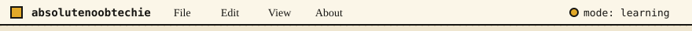
 
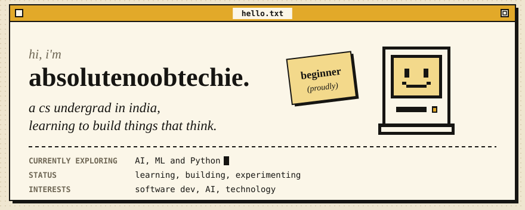
 
<a href="desk/about.md">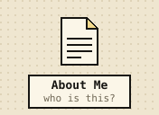</a><a href="desk/journal.md">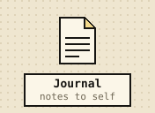</a><a href="desk/reading.md">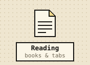</a><a href="https://github.com/absolutenoobtechie?tab=repositories&q=topic%3Aexperiments">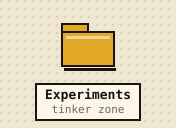</a><a href="desk/ideas-that-didnt-work.md">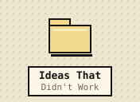</a>
 
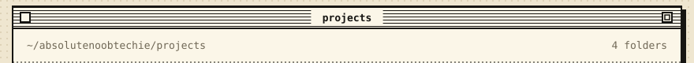 <a href="https://github.com/absolutenoobtechie?tab=repositories&q=topic%3Abuilt">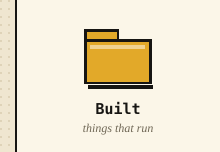</a><a href="https://github.com/absolutenoobtechie?tab=repositories&q=topic%3Ain-progress">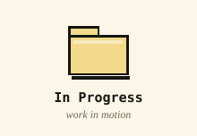</a><a href="https://github.com/absolutenoobtechie?tab=repositories&q=topic%3Aexperiments">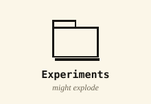</a><a href="https://github.com/absolutenoobtechie?tab=repositories&q=topic%3Aarchived">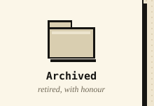</a> 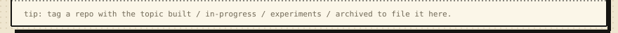
 
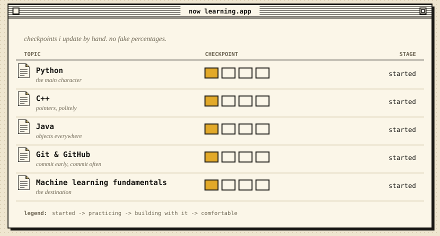
 
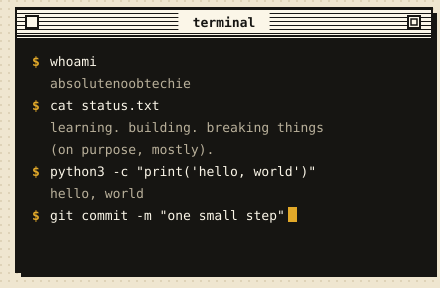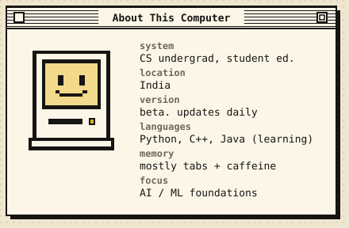
 
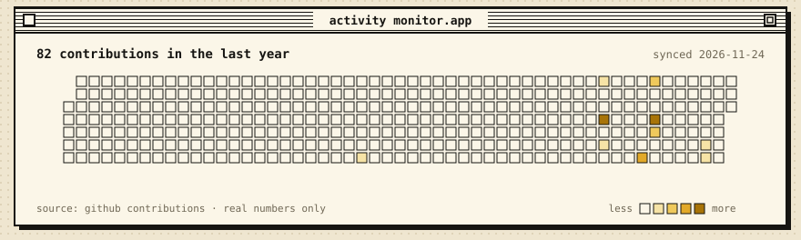
 
<a href="desk/ideas-that-didnt-work.md">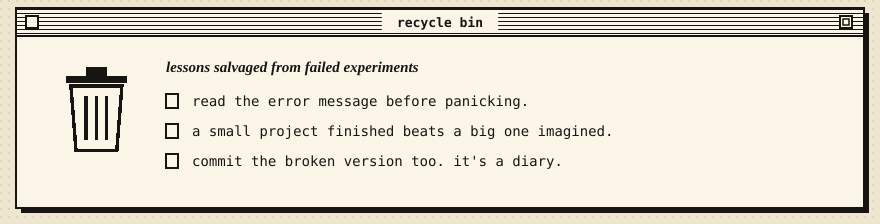</a>
 
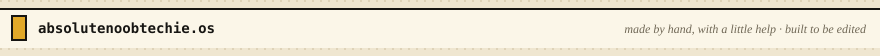

plain-text version (if the pictures don't load)

**hi, i'm absolutenoobtechie.**
a cs undergrad in india, learning to build things that think.

- **Currently exploring:** AI, ML and Python
- **Status:** learning, building and experimenting
- **Interests:** software development, AI and technology

**Now learning:** Python · C++ · Java · Git & GitHub · machine learning fundamentals

**Projects:** [Built](https://github.com/absolutenoobtechie?tab=repositories&q=topic%3Abuilt) · [In Progress](https://github.com/absolutenoobtechie?tab=repositories&q=topic%3Ain-progress) · [Experiments](https://github.com/absolutenoobtechie?tab=repositories&q=topic%3Aexperiments) · [Archived](https://github.com/absolutenoobtechie?tab=repositories&q=topic%3Aarchived)

**Desktop:** [About Me](desk/about.md) · [Journal](desk/journal.md) · [Reading](desk/reading.md) · [Ideas That Didn't Work](desk/ideas-that-didnt-work.md)

